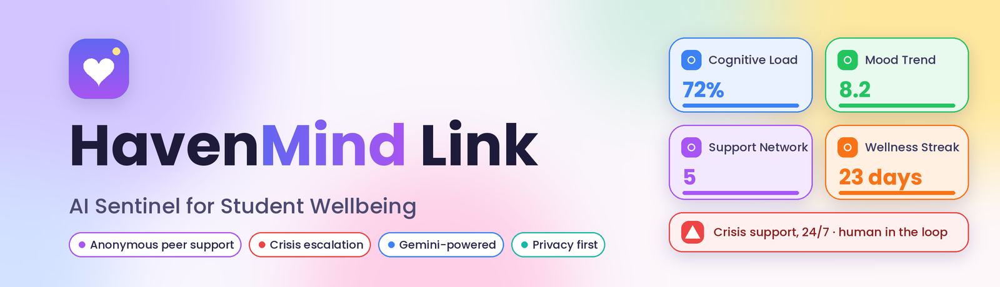
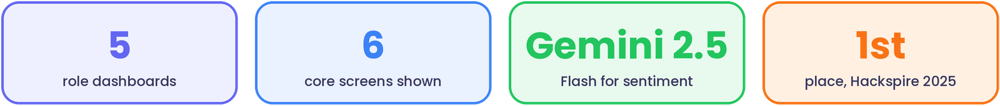
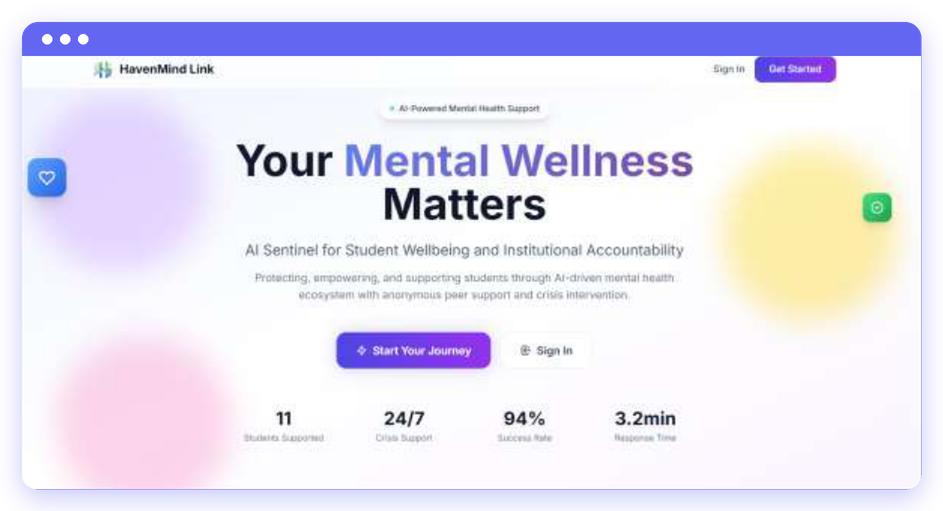
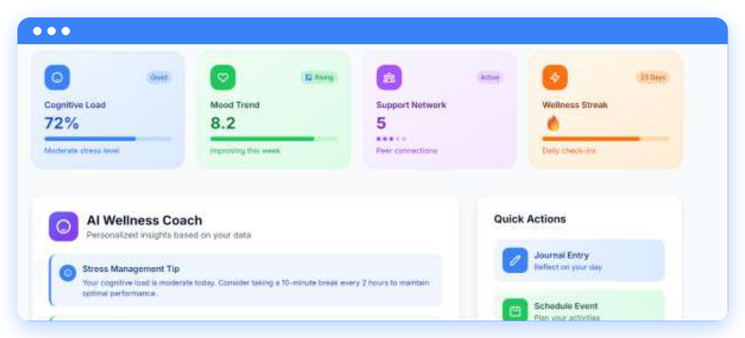
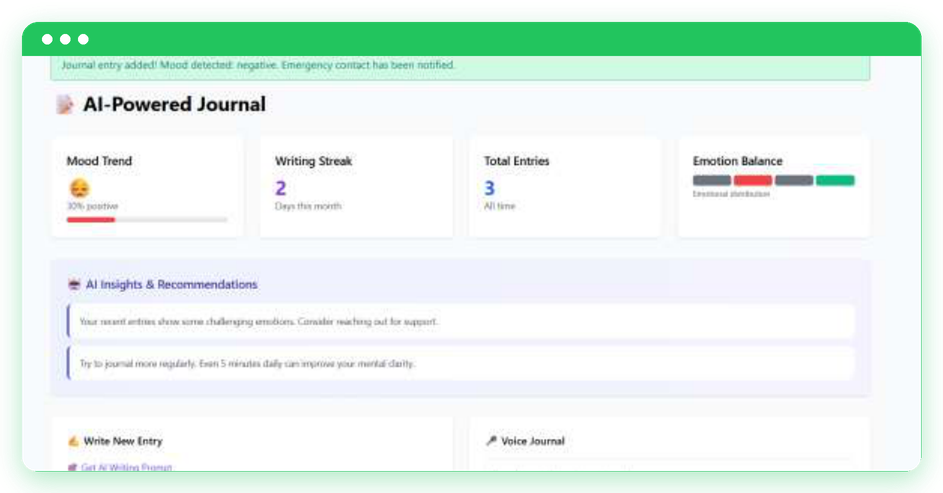
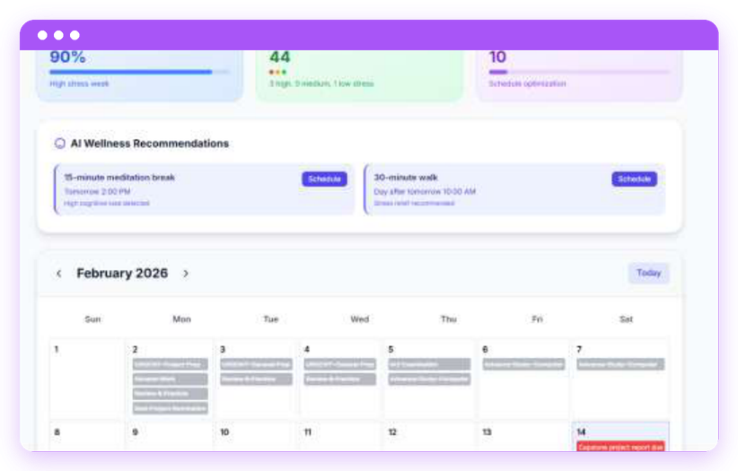
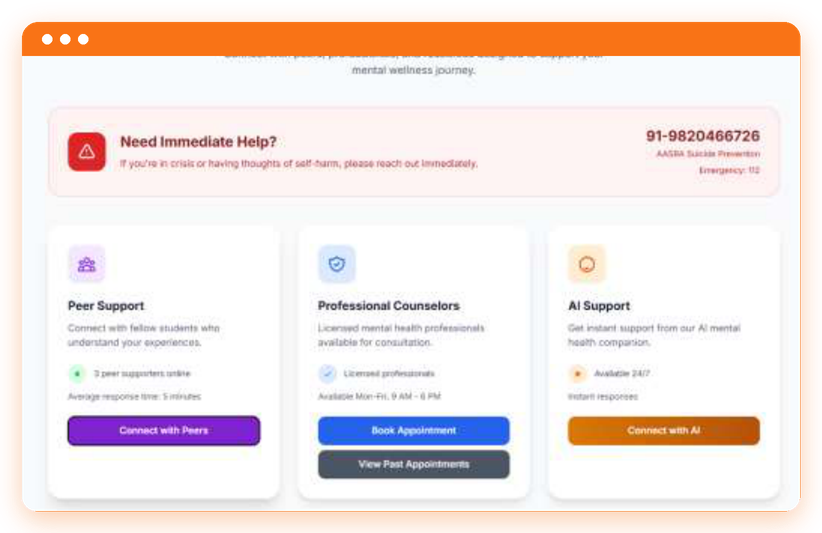
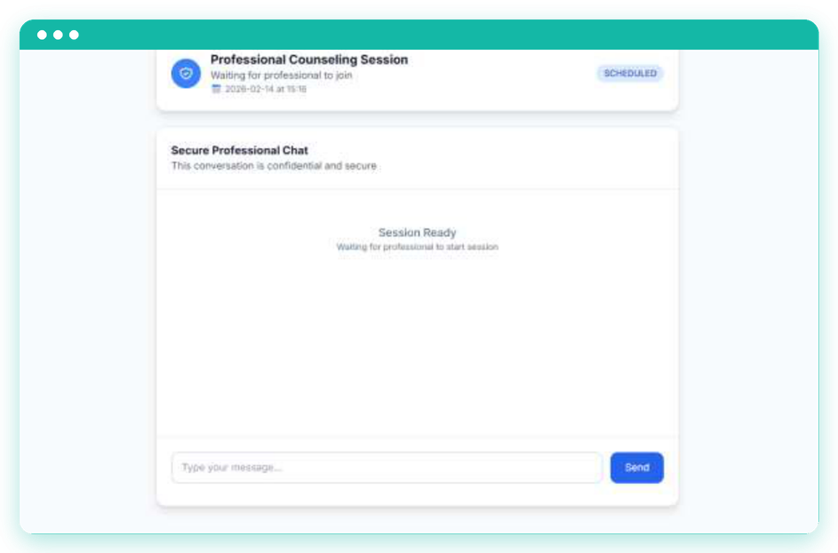

<a href="https://github.com/smritis21/HavenMind-Link"></a>

<p align="center">


</p>

<p align="center">
<a href="#overview">Overview</a> · <a href="#screenshots">Screenshots</a> · <a href="#features">Features</a> · <a href="#roles">Roles</a> · <a href="#tech-stack">Tech stack</a> · <a href="#quick-start">Quick start</a> · <a href="#configuration">Configuration</a> · <a href="#testing">Testing</a> · <a href="#crisis-resources">Crisis resources</a> · <a href="#roadmap">Roadmap</a> · <a href="#contact">Contact</a>
</p>

* * *

**HavenMind Link** is an AI-assisted student wellbeing platform that brings **students, peer supporters, professional counselors and institutional administrators** into one support system. It uses Google Gemini for sentiment analysis of journal entries, personalised wellness guidance and early crisis signals, while keeping a human in the loop for anything serious. Winner of **1st place at Hackspire 2025**, and the platform behind the research paper *Explainable Behavioural Stress Modelling for Student Wellbeing: The QARM-SL Framework and HavenMind Link Platform* (ICCCMIT 2026).



## Overview

<table>
<tr>
<td width="50%" valign="top">

**The problem**

- 1 in 4 students experience mental health challenges
- Around 60% don't seek help because of stigma
- 24/7 support is rarely available on campus
- Early intervention systems are rare

</td>
<td width="50%" valign="top">

**The approach**

- Real-time AI monitoring for early intervention
- Anonymous peer support to lower the stigma barrier
- Professional crisis management for serious cases
- Institution-level analytics for resource planning

</td>
</tr>
</table>

* * *

## Screenshots

Each screen has its own accent colour, used again in the feature and role sections below.


<a href="assets/landing.png"></a>

<table>
<tr>
<td width="50%" valign="top">
<br>
<a href="assets/student-dashboard.png"></a>
<sub>Cognitive load, mood trend, support network and wellness streak, with an AI wellness coach and quick actions.</sub>
</td>
<td width="50%" valign="top">
<br>
<a href="assets/journal.png"></a>
<sub>Sentiment-aware journaling with emotion balance, AI insights, voice entries and emergency-contact alerts.</sub>
</td>
</tr>
<tr>
<td width="50%" valign="top">
<br>
<a href="assets/calendar.png"></a>
<sub>Stress forecasting from upcoming events, with time-proximity escalation and suggested wellness breaks.</sub>
</td>
<td width="50%" valign="top">
<br>
<a href="assets/support.png"></a>
<sub>Peer, counselor and AI support in one place, with crisis contacts always on screen.</sub>
</td>
</tr>
</table>


<a href="assets/counselor.png"></a>

<sub>A confidential professional chat session, plus scheduled and completed appointment history.</sub>

* * *

## Features

<table>
<tr>
<td width="50%" valign="top">


- **Google Gemini** for sentiment analysis and therapeutic responses
- **Real-time cognitive load analysis** from journal and calendar signals
- **Crisis detection** with automatic emergency alerts
- **Predictive stress modelling** from calendar events and journal patterns
- **NLP** for contextual understanding, with a simple fallback AI when the API is unavailable

</td>
<td width="50%" valign="top">


- **Anonymous peer chat** with full identity protection
- **HIPAA-aligned** privacy safeguards
- **Role-based access control** and secure sessions
- **Human in the loop**: the AI suggests, people decide
- Crisis cases escalate to professionals, never stay with the bot

</td>
</tr>
<tr>
<td width="50%" valign="top">


- Voice input: *"Math exam tomorrow 9 AM"*
- Automatic stress level per event (minimal, low, medium, high, critical)
- Stress escalates as the deadline gets closer
- AI-suggested wellness breaks, one tap to schedule

</td>
<td width="50%" valign="top">


- Priority-sorted request queue for supporters
- AI-assisted response suggestions and risk flags
- Escalation recommendations and case history
- Anonymous chat management, available around the clock

</td>
</tr>
</table>

* * *

## Roles

| | Role | What they get |
| --- | --- | --- |
|  | **Student** | AI wellness coach, real-time cognitive load, mood trends, voice-enabled calendar with stress forecasting, anonymous peer chat, crisis support with emergency contacts |
|  | **Peer supporter** | Priority-sorted support queue, AI-assisted replies, crisis escalation tools, case history |
|  | **Professional counselor** | Crisis intervention management, student profile analysis, confidential session notes, appointment scheduling |
|  | **Institution admin** | University-wide wellness analytics, department-level insights, crisis alert coordination, resource allocation guidance |
|  | **NGO** | Community outreach integration, resource coordination, volunteer management |

* * *

## Tech stack

| | |
| --- | --- |
| **Backend** |     |
| **AI** |     |
| **Frontend** |     |
| **Optional** |   |

* * *

## Quick start

**Prerequisites:** Python 3.8+, pip and Git.

```bash
# 1. Clone
git clone https://github.com/smritis21/HavenMind-Link.git
cd HavenMind-Link/havenmind-basic

# 2. Install
pip install -r requirements.txt

# 3. Configure (see the next section)
cp .env.example .env

# 4. Run (the database is created on first run)
python app.py
```

Open <http://localhost:5000>, create an account or use a demo login.

<details>
<summary><b>Demo accounts</b></summary>

| Role | Username | Password |
| --- | --- | --- |
| Student | `demo_student` | `password123` |
| Peer supporter | `demo_peer` | `password123` |
| Counselor | `demo_counselor` | `password123` |
| Admin | `demo_admin` | `password123` |

These are for local demos only. Change them before deploying anywhere.

</details>

<details>
<summary><b>Project structure</b></summary>

```
havenmind-link/
├── havenmind-basic/               # Main Flask application
│   ├── app.py                     # Core application (2000+ lines)
│   ├── templates/                 # HTML templates for all roles
│   │   ├── auth/                  # Authentication pages
│   │   ├── dashboards/            # Role-specific dashboards
│   │   └── *.html                 # Main pages
│   ├── static/                    # CSS, JS and assets
│   ├── notification_system.py     # Crisis alert system
│   ├── simple_ai.py               # Fallback AI responses
│   ├── daily_scheduler.py         # Wellness reminders
│   ├── requirements.txt           # Python dependencies
│   └── .env.example               # Environment configuration
├── havenmind-backend/             # Advanced backend features
│   ├── app/                       # Backend application
│   ├── utils/                     # AI and ML utilities
│   └── requirements.txt
├── docs/                          # Documentation and guides
├── README.md
├── LICENSE                        # MIT
└── .gitignore
```

</details>

* * *

## Configuration

Create a `.env` file inside `havenmind-basic/`:

```env
# AI
GEMINI_API_KEY=your_gemini_api_key_here

# Flask
FLASK_ENV=development
SECRET_KEY=your_super_secret_key_here
FLASK_DEBUG=True

# Database
DATABASE_URL=sqlite:///havenmind.db

# SMS (optional)
TWILIO_ACCOUNT_SID=your_twilio_sid
TWILIO_AUTH_TOKEN=your_twilio_token
TWILIO_PHONE_NUMBER=your_twilio_phone

# Email (optional)
SMTP_SERVER=smtp.gmail.com
SMTP_PORT=587
EMAIL_ADDRESS=your_email@example.com
EMAIL_PASSWORD=your_app_password
```

| Key | Where to get it |
| --- | --- |
|  | Create an API key in [Google AI Studio](https://aistudio.google.com/app/apikey) and paste it into `.env` |
|  | Optional. Sign up at [Twilio](https://www.twilio.com/) for the SID, token and number to enable SMS alerts |
|  | Optional. A Gmail app password or any SMTP service enables emergency emails |

Never commit your real `.env`. The `.gitignore` already excludes it.

* * *

## Testing

```bash
python run_tests.py                  # full suite
python test_gemini_integration.py    # AI functionality
python test_crisis_detection.py      # crisis detection
python test_security_fix.py          # security features
```

Manual scenarios worth walking through: registration and login, role-based dashboard access, sentiment analysis accuracy, crisis detection and escalation, anonymous chat, and the emergency notification flow.

* * *

## Crisis resources

<table>
<tr>
<td valign="top">


**These numbers are for India, where the platform was built and demoed.** If you are elsewhere, please contact your local emergency number or crisis line.

- Emergency services: **112**
- AASRA suicide prevention: **91-9820466726**
- Vandrevala Foundation: **1860-2662-345**
- iCall helpline: **022-25521111**

HavenMind Link supports, and does not replace, professional mental health care.

</td>
</tr>
</table>

* * *

## Roadmap

| Phase | Timeline | Focus |
| --- | --- | --- |
|  | Next 6 months | Custom ML model training, predictive risk assessment, behavioural pattern recognition, voice journal, multi-language support |
|  | 6 to 12 months | Multi-university deployment, campus system integrations, counselor network, mobile app, cloud migration |
|  | 12+ months | Academic research partnerships, outcome studies, model validation, policy and compliance framework |

* * *

## Contributing

Contributions from developers, mental health professionals and students are welcome.

1. Fork the repository and create a branch: `git checkout -b feature/amazing-feature`
2. Make your changes and add tests for new functionality
3. Commit, push and open a pull request: `git commit -m "Add amazing feature"`

Please follow the existing code style, update the docs for any change, make sure the tests pass, and respect privacy and security standards. Useful areas: bug fixes, new features, docs, test coverage, UI/UX and internationalisation.

## License

Released under the [MIT License](LICENSE).

* * *

## Contact

Built by **Smriti Sridhar**, MSc Artificial Intelligence at Leiden University. Open to working-student roles, research collaborations and conversations about AI systems for wellbeing.

<p>
<a href="https://smriti-sridhar.web.app/"></a>
<a href="https://www.linkedin.com/in/smriti-s-72647827b/"></a>
<a href="https://github.com/smritis21"></a>
<a href="mailto:smriti.iyer05@gmail.com"></a>
</p>

<p align="center"><sub>Made with care for student mental health and wellbeing. <a href="#">Back to top</a></sub></p>
